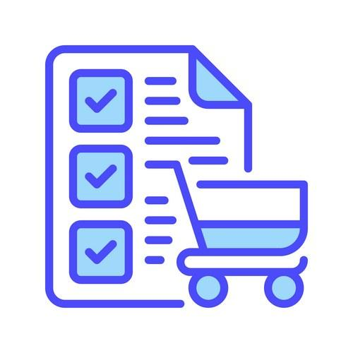

<div align="center">

  

  <h1>SAP Ariba Complete Guide</h1>

  <p>
    A practical, end-to-end SAP Ariba knowledge base for learners,
    functional consultants, implementation teams,
    integration/support engineers, and interview preparation.
  </p>

  <p>
    
    
    
  </p>

</div>

---

> **Status:** Active learning and reference project  
> **Focus:** SAP Ariba • P2O • S2C • Business Network • Integration • SAP MM • Production Support • Interview Preparation
---
## 👥 Who Should Use This Repository?

This repository is designed for different SAP Ariba learning and career paths.  
Use the path below based on your current role or goal.

| If you are... | Start with... |
|---|---|
| 🧑‍🎓 **New to SAP Ariba** | Architecture → S2C → P2O |
| 🧩 **SAP Ariba Functional Consultant** | S2C → P2O → Business Network |
| 🔗 **Integration Engineer** | Architecture → PnI → ECC T-Codes |
| 🛠️ **Production Support Engineer** | PnI → ECC T-Codes → Production Support |
| 📦 **SAP MM Professional** | SAP MM → P2O → Integration |
| 🎯 **Preparing for SAP Ariba Interviews** | Interview Questions → Production Support Scenarios |
| 🚀 **Moving from Support to Consulting** | P2O → PnI → SAP MM → Production Support Scenarios |

### Recommended Starting Points

- **Want to understand SAP Ariba from scratch?**  
  Start with `01-Architecture.md`, then move through S2C and P2O.

- **Want to understand integration and troubleshooting?**  
  Start with `05-PnI-Integration.md`, followed by `06-ECC-TCodes.md` and `09-Production-Support-Scenarios.md`.

- **Want to prepare for interviews?**  
  Start with `08-SAP-Ariba-Interview-Questions-Answers.md`, then test your practical troubleshooting knowledge with `09-Production-Support-Scenarios.md`.

- **Want to strengthen SAP ERP/MM knowledge?**  
  Start with `07-SAP-MM.md`, then connect it with P2O and the integration guides.

- **Want to move from support into consulting/implementation?**  
  Follow the P2O → PnI → SAP MM → Production Support path and use the interview guide for practical revision.

---

# 📌 What This Repository Is

This repository is being built as a **single practical reference point for SAP Ariba** rather than a collection of disconnected notes.

It connects the major concepts an SAP Ariba professional needs to understand:

```text
Business Requirement
        ↓
SAP Ariba Applications
        ↓
S2C / P2O
        ↓
SAP Business Network
        ↓
Platform & Integration
        ↓
SAP ECC / S/4HANA
        │
        ├── SAP MM
        │     ├── Purchasing
        │     ├── Inventory
        │     ├── Goods Movement
        │     └── Invoice Verification
        │
        └── SAP FI
              └── Accounting / Financial Posting
        ↓
Master Data + Transaction Data
        ↓
Monitoring + Troubleshooting
        ↓
Implementation + Production Support
        ↓
Interview Preparation
```

The goal is **not** to claim that one repository can document every SAP Ariba feature or every customer configuration. SAP capabilities, terminology, releases, integrations, and configuration can change.

The goal is to build a **structured, practical and continuously expandable reference** covering the concepts, flows, technical layers, examples, troubleshooting patterns, implementation knowledge, production-support reasoning, and interview preparation that matter most.

---

# 🚀 Start Here

If you are new to SAP Ariba, follow this order:

```text
1. Understand the ecosystem
          ↓
2. Learn the architecture
          ↓
3. Learn S2C
          ↓
4. Learn P2O
          ↓
5. Learn Business Network
          ↓
6. Learn PnI / Integration
          ↓
7. Understand SAP MM / ERP processing
          ↓
8. Practice transaction flows
          ↓
9. Learn production troubleshooting
          ↓
10. Practice real support scenarios
          ↓
11. Prepare for interviews
```

---

# 📚 Core Guides

| # | Guide | Focus | Best For |
|---|---|---|---|
| 📐 01 | [Architecture](./01-Architecture.md) | SAP Ariba architecture, Business Network, Managed Gateway / CIG, Cloud Connector, ECC / S/4HANA, integration layers, data flows, and troubleshooting by layer | Architecture / Integration / Support |
| 📘 02 | [S2C — Source-to-Contract](./02-S2C-Source-to-Contract.md) | Source-to-Contract, SLP, supplier lifecycle, sourcing, RFI/RFP/RFQ, auctions, evaluation, awards, and contracts | Functional / S2C |
| 📗 03 | [P2O — Procure-to-Order](./03-P2O-Procure-to-Order.md) | Procurement execution, Buying, Guided Buying, catalogs, PR, approvals, PO, receiving, invoicing, and reconciliation | P2O / P2P / Functional / Support |
| 🌐 04 | [Business Network](./04-Business-Network.md) | Buyer-supplier collaboration, PO, confirmation, ASN, receipt, invoice, routing, and supplier connectivity | Network / Supplier Collaboration |
| 🔌 05 | [PnI — Integration](./05-PnI-Integration.md) | Managed Gateway / CIG, Cloud Connector, cXML/XML, APIs, payloads, ECC, monitoring, errors, and troubleshooting | Integration / Technical / Support |
| 🛠️ 06 | [ECC T-Codes](./06-ECC-TCodes.md) | ECC/S/4HANA transaction codes for logs, IDocs, web services, jobs, errors, and troubleshooting | Integration / Production Support |
| 🏭 07 | [SAP MM](./07-SAP-MM.md) | SAP MM fundamentals, organizational structure, procurement, inventory, goods movement, invoice verification, T-Codes, troubleshooting, and Ariba/MM integration | Ariba / P2P / ERP |
| 🎯 08 | [SAP Ariba Interview Questions](./08-SAP-Ariba-Interview-Questions-Answers.md) | Conceptual, functional, technical, integration, support, consulting, and scenario-based questions | Interview Preparation |
| 🚨 09 | [Production Support Scenarios](./09-Production-Support-Scenarios.md) | 50 practical production incidents, HTTP errors, Cloud Connector issues, ERP failures, RCA, safe reprocessing, and support decision-making | Production Support / Integration / Interview |

---

# 🧭 The SAP Ariba Mental Model

A useful way to understand the ecosystem is to separate the major Ariba areas from the ERP-side processing layer.

```text
                         SAP ARIBA ECOSYSTEM
                                  │
              ┌───────────────────┼───────────────────┐
              │                   │                   │
              ▼                   ▼                   ▼
             S2C                 P2O                 PnI
      Source-to-Contract   Procure-to-Order   Platform & Integration
              │                   │                   │
              └───────────────────┼───────────────────┘
                                  │
                                  ▼
                         SAP BUSINESS NETWORK
                                  │
                                  ▼
                              SUPPLIERS
                                  │
                                  ▼
                           SAP ECC / S/4HANA
                                  │
                     ┌────────────┴────────────┐
                     │                         │
                   SAP MM                    SAP FI
                     │                         │
             Procurement / Inventory       Accounting
             Goods Movement
             Invoice Verification
```

> **Important:** SAP MM is an ERP-side functional area within SAP ERP / SAP S/4HANA. It is not a separate system underneath ECC or S/4HANA.

---

# 1. S2C — Source-to-Contract

S2C answers:

> **How does an organization identify, evaluate, negotiate with, and establish commercial relationships with suppliers?**

Major areas include:

- Supplier Lifecycle and Performance
- Supplier request
- Supplier registration
- Supplier qualification
- Supplier lifecycle
- Sourcing requests
- RFI
- RFP
- RFQ
- Auctions
- Bidding
- Evaluation
- Award
- Contracts
- Sourcing-to-contract

See: [02 — S2C](./02-S2C-Source-to-Contract.md)

---

# 2. P2O — Procure-to-Order

P2O answers:

> **How does an organization turn an approved business requirement into a purchase and execute the procurement transaction?**

Major areas include:

- Core administration
- Users and groups
- Organization/master data
- Catalogs
- CIF
- PunchOut
- Guided Buying
- Shopping
- Purchase requisition
- Approval workflow
- Accounting
- Purchase order
- Receiving
- Service receipt
- Invoice
- Invoice reconciliation
- Exceptions

## P2O vs P2P

In this repository:

- **P2O (Procure-to-Order)** refers to the procurement execution layer.
- **P2P (Procure-to-Pay)** refers to the broader lifecycle including receiving, invoicing, reconciliation, and payment.

See: [03 — P2O](./03-P2O-Procure-to-Order.md)

---

# 3. PnI — Platform & Integration

PnI answers:

> **How do Ariba and enterprise systems exchange data and process transactions technically?**

Major areas include:

- SAP Integration Suite
- Managed Gateway / CIG terminology
- SAP Cloud Connector
- SAP ECC
- SAP S/4HANA
- cXML
- XML
- REST
- SOAP
- APIs
- IDoc
- Proxy
- Authentication
- Authorization
- Payload analysis
- Mapping
- Value mapping
- Cross-reference
- Monitoring
- Transaction tracking
- Error handling
- Reprocessing

See: [05 — PnI](./05-PnI-Integration.md)

---

# 4. SAP Business Network

Business Network answers:

> **How do buyers and suppliers collaborate and exchange procurement transactions?**

Major areas include:

- Buyer account
- Supplier account
- Trading relationships
- Supplier onboarding
- Supplier connectivity
- Purchase orders
- Order confirmations
- Advance Ship Notices
- Goods receipt
- Invoices
- Credit memos
- Routing
- Supplier-side integration
- Transaction status

See: [04 — Business Network](./04-Business-Network.md)

---

# 🔄 End-to-End Procurement Flow

A simplified end-to-end procurement model:

```text
                    BUSINESS NEED
                         │
                         ▼
                  PURCHASE REQUISITION
                         │
                         ▼
                   APPROVAL / POLICY
                         │
                         ▼
                    PURCHASE ORDER
                         │
                         ▼
                  SAP BUSINESS NETWORK
                         │
                         ▼
                       SUPPLIER
                      ┌────┴────┐
                      │         │
                      ▼         ▼
                CONFIRMATION   ASN
                      │         │
                      └────┬────┘
                           ▼
                      GOODS RECEIPT
                           │
                           ▼
                         INVOICE
                           │
                           ▼
                  INVOICE RECONCILIATION
                     ┌─────┴─────┐
                     │           │
                    PASS      EXCEPTION
                     │           │
                     │           ▼
                     │       RESOLUTION
                     │           │
                     └─────┬─────┘
                           ▼
                     PAYMENT PROCESS
```

> Not every business process uses every document. Service procurement and customer-specific processes can follow different paths.

---

# 🌐 Buyer → Network → Supplier

A procurement transaction does not stop when the buyer creates a PO.

```text
BUYER
  │
  ▼
SAP Ariba / ERP
  │
  │ PO
  ▼
SAP BUSINESS NETWORK
  │
  │ Routing / Collaboration
  ▼
SUPPLIER
  │
  ├── Confirmation
  ├── ASN
  └── Invoice
  │
  ▼
SAP BUSINESS NETWORK
  │
  ▼
BUYER
```

This is why **SAP Business Network should be understood separately from the buyer-side procurement application**.

---

# 🔌 Technical Integration Flow

For integration and support work, a business transaction can become a multi-layer technical transaction.

```text
┌─────────────────────────────┐
│ SAP Ariba / Business Network│
└──────────────┬──────────────┘
               │
               │ HTTPS / cXML / API
               ▼
┌─────────────────────────────┐
│ SAP Integration Suite,      │
│ Managed Gateway / CIG       │
└──────────────┬──────────────┘
               │
               ▼
┌─────────────────────────────┐
│ Integration / Middleware    │
│ Mapping / Transformation    │
└──────────────┬──────────────┘
               │
               ▼
┌─────────────────────────────┐
│ SAP Cloud Connector         │
└──────────────┬──────────────┘
               │
               │ Secure connectivity
               ▼
┌─────────────────────────────┐
│ SAP ECC / S/4HANA           │
│ IDoc / Proxy / API          │
└──────────────┬──────────────┘
               │
               ▼
┌─────────────────────────────┐
│ SAP Business Processing     │
│ MM / FI / Other ERP Areas   │
└─────────────────────────────┘
```

> **Important:** This is a conceptual architecture. Customer landscapes can differ depending on products, release, integration approach, and configuration.

---

# 🧩 Upstream vs Downstream

One of the most useful support concepts is understanding where a problem originates.

## Upstream

```text
Business Requirement
        ↓
Ariba Transaction
        ↓
Business Network
        ↓
Integration
        ↓
ERP
```

If source data is wrong upstream, downstream systems may simply process incorrect information.

### Example

```text
Expected Plant = 1001

Source payload:
Plant = 1999

ERP:
Plant 1999 does not exist
```

The final error appears in ERP, but the root cause may be upstream data or mapping.

## Downstream

A transaction may be correct at the source but fail later:

```text
Ariba
  ↓ SUCCESS
Gateway
  ↓ SUCCESS
Middleware
  ↓ SUCCESS
Cloud Connector
  ↓ SUCCESS
ECC
  ↓ FAILURE
Business Validation
```

> **Where the error appears is not always where the root cause originated.**

---

# 🗃️ Master Data vs Transaction Data

This distinction is fundamental.

## Master Data

Examples:

- Supplier
- User
- Material
- Plant
- Company code
- Purchasing organization
- Purchasing group
- Cost center
- GL account
- Currency
- UOM
- Payment terms
- Tax data
- Commodity/category

```text
MASTER DATA
     │
     ▼
Enables transactions
```

## Transaction Data

Examples:

- Purchase requisition
- Purchase order
- Order confirmation
- ASN
- Goods receipt
- Invoice
- Credit memo

```text
TRANSACTION
     │
     ▼
Uses master data
```

### Typical Failure

```text
Master Data Incorrect
        ↓
Transaction Created
        ↓
Integration
        ↓
Backend Rejection
```

---

# 📦 Core Transaction Documents

| Document | Business Meaning | Typical Direction |
|---|---|---|
| PR | Purchase requirement/request | Buyer process |
| PO | Buyer order to supplier | Buyer → Supplier |
| OC | Supplier response to PO | Supplier → Buyer |
| ASN | Supplier shipment notification | Supplier → Buyer |
| GR | Buyer records receipt | Buyer / ERP |
| SES / Service Sheet | Service confirmation | Depends on process |
| Invoice | Supplier billing request | Supplier → Buyer |
| Credit Memo | Financial adjustment | Supplier → Buyer |
| Payment Request | Payment-processing representation | Buyer / ERP |

Conceptual document chain:

```text
PR
 ↓
PO
 ↓
OC
 ↓
ASN
 ↓
GR
 ↓
Invoice
 ↓
Reconciliation
 ↓
Payment
```

---

# 🧠 What Each Area Answers

| Question | Area |
|---|---|
| Who is the supplier? | Supplier Management |
| Should we work with this supplier? | SLP |
| Which supplier should win the business? | Sourcing |
| What commercial terms were agreed? | Contracts |
| What does the employee need to buy? | Procurement |
| How is the request approved? | Approval / P2O |
| How does the user buy? | Buying / Guided Buying |
| Where does the product/service come from? | Catalog / Supplier |
| What did the buyer order? | PO |
| How does the supplier respond? | Business Network |
| What did the supplier ship? | ASN |
| What did the buyer receive? | GR |
| What did the supplier bill? | Invoice |
| Does the invoice match? | Reconciliation |
| How does the message move between systems? | PnI |
| What executes procurement in the ERP? | SAP MM / ERP |
| Where are goods movements recorded? | SAP MM |
| Where is invoice verification performed? | SAP MM / ERP |
| Why did the transaction fail? | Troubleshooting |
| How do we implement the solution? | Implementation |
| How do we support it in production? | Production Support |
| How do I prepare for an interview? | Interview Preparation |

---

# 👨‍💼 Functional Consultant View

A functional consultant should be able to move from:

```text
Business Requirement
        ↓
Process Design
        ↓
SAP Ariba Configuration
        ↓
Master Data
        ↓
Integration Requirement
        ↓
Testing
        ↓
Go-Live
        ↓
Support
```

Before configuring anything, ask:

1. What is the current business process?
2. What is the desired process?
3. Which users perform each step?
4. Which documents are created?
5. Which approvals are required?
6. Which master data is required?
7. Which suppliers participate?
8. Which systems are involved?
9. Which integrations are required?
10. What are the exception scenarios?
11. How will the process be tested?
12. What happens after go-live?

---

# 🏗️ Implementation View

A practical implementation lifecycle:

```text
Requirement Gathering
        ↓
Discovery
        ↓
Fit-Gap
        ↓
Solution Design
        ↓
Configuration
        ↓
Integration
        ↓
Unit Testing
        ↓
SIT
        ↓
UAT
        ↓
Cutover
        ↓
Go-Live
        ↓
Hypercare
        ↓
Support
```

Implementation should answer:

- What are we implementing?
- Why?
- For whom?
- What data is required?
- What integrations are required?
- What is standard?
- What needs configuration?
- What needs extension?
- How will it be tested?
- How will cutover work?
- How will production support work?

---

# 🛠️ Production Support View

A production support engineer should not start with:

> "Let's retry the transaction."

Start with:

```text
1. Understand business impact
          ↓
2. Identify document
          ↓
3. Identify transaction ID
          ↓
4. Determine direction
          ↓
5. Locate transaction
          ↓
6. Read exact error
          ↓
7. Inspect payload
          ↓
8. Identify failure layer
          ↓
9. Find root cause
          ↓
10. Fix
          ↓
11. Reprocess safely
          ↓
12. Validate business result
          ↓
13. Document RCA
```

## Failure Layers

```text
Network
   ↓
Authentication
   ↓
Authorization
   ↓
Payload / XML
   ↓
Mapping
   ↓
Gateway
   ↓
Middleware
   ↓
Cloud Connector
   ↓
ECC Interface
   ↓
ECC Application
   ↓
Business Configuration
```

---

# 🚨 Common Production Issues

## Procurement

- PR stuck in approval
- Wrong approver
- Catalog item unavailable
- Wrong accounting
- PO not generated
- PO change not reflected
- Receiving issue

## Business Network

- Supplier cannot see PO
- Wrong supplier account
- Trading relationship problem
- PO routing failure
- Confirmation missing
- ASN missing
- Invoice missing
- Duplicate document

## Integration

- Authentication failure
- Certificate issue
- Connectivity timeout
- Mapping failure
- Missing value mapping
- Invalid XML
- Invalid cXML
- Wrong endpoint
- Middleware failure
- Cloud Connector issue
- ECC interface failure
- Backend business rejection

## Invoice

- Quantity mismatch
- Price mismatch
- Tax mismatch
- Currency mismatch
- Duplicate invoice
- Missing PO
- Receipt mismatch
- Tolerance exception

---

# 🚨 HTTP Error Quick Reference

These are **first-pass troubleshooting classifications**, not absolute root-cause rules. Always identify which component returned the status and inspect the accompanying response/logs.

| HTTP | Classification | First Investigation | Typical Evidence |
|---|---|---|---|
| **401** | Authentication | Gateway / endpoint authentication | Credentials, token, authentication response, endpoint logs |
| **403** | Authorization | Cloud Connector access controls / endpoint permissions | Access control, resource exposure, authorization response |
| **404** | Endpoint / Resource | URL, mapping, path | Request URL, virtual/internal host mapping, endpoint configuration |
| **500** | Backend / Application | ERP/application | ERP logs, application errors, interface/business processing |

```text
401
 ↓
Authentication
 ↓
Gateway / endpoint logs
 ↓
Credential / token investigation
```

```text
403
 ↓
Authorization
 ↓
Cloud Connector / access controls
 ↓
Permissions investigation
```

```text
404
 ↓
Endpoint / Resource
 ↓
URL / mapping / path
 ↓
Endpoint investigation
```

```text
500
 ↓
Backend / Application
 ↓
ERP logs
 ↓
Business / interface investigation
```

> **Do not diagnose the entire integration from an HTTP code alone. Identify the component that generated the response first.**

---

# 🧪 Production Support Scenarios

The repository now includes a dedicated runbook with **50 practical production-support scenarios**.

See:

**[09 — Production Support Scenarios](./09-Production-Support-Scenarios.md)**

It covers scenarios including:

- PO not reaching supplier
- PO exists in Ariba but not ERP
- Cloud Connector green but transaction fails
- HTTP 401 / 403 / 404 / 500
- Supplier cannot see PO
- Missing confirmation
- Missing ASN
- GR/status propagation issues
- Invoice quantity mismatch
- Invoice price mismatch
- Duplicate invoice
- Timeout followed by duplicate
- Invalid plant
- Invalid material
- Invalid supplier
- Cost center rejection
- Mapping/value-mapping failure
- Valid XML but failed business transaction
- Authentication vs authorization
- Certificate expiry
- Cloud Connector tunnel/resource problems
- IDoc failure
- Web-service failure
- Background job failure
- Application log errors
- ABAP runtime errors
- Wrong approver
- PR stuck in approval
- Catalog issues
- Supplier onboarding
- Wrong supplier account
- PO change not reflected
- Partial delivery
- Retry vs do-not-retry decisions
- Technical success vs business failure
- Business success but missing status update
- Repeated failure after reprocessing
- Failure after a change
- One supplier failing
- All suppliers failing
- Environment differences
- Backend rejection despite apparently correct payload
- Currency/UOM issues
- Master-data-driven failures
- Multi-component production incidents

---

# 🧠 Production Support Mental Model

When an incident arrives, think:

```text
WHAT happened?
      ↓
WHICH document?
      ↓
WHICH direction?
      ↓
WHERE was it last successful?
      ↓
WHERE did it first fail?
      ↓
WHAT exact error?
      ↓
WHO generated the error?
      ↓
WHAT evidence proves the cause?
      ↓
WHAT must be fixed?
      ↓
IS retry safe?
      ↓
DID the business result succeed?
      ↓
HOW do we prevent recurrence?
```

The objective is not:

> "Make the error disappear."

The objective is:

> **Restore the business process safely, prove the transaction is correct, and prevent the same failure from recurring.**

---

# 🧱 Production Support Decision Framework

For difficult incidents:

```text
Business Impact
      ↓
Document / Transaction
      ↓
Direction
      ↓
Last Successful Layer
      ↓
First Failed Layer
      ↓
Exact Error
      ↓
Error Source
      ↓
Payload / Data
      ↓
Master Data / Configuration
      ↓
Root Cause
      ↓
Resolution
      ↓
Safe Reprocessing
      ↓
Business Validation
      ↓
RCA / Prevention
```

A strong support engineer distinguishes:

```text
Symptom
   ≠
Failure Point
   ≠
Root Cause
```

---

# 🗺️ Learning Paths

## 👨‍🎓 Beginner

```text
SAP Ariba Fundamentals
        ↓
Architecture
        ↓
P2O
        ↓
Business Network
        ↓
SAP MM / ERP Fundamentals
        ↓
S2C
        ↓
PnI Basics
        ↓
ECC / T-Codes
        ↓
Production Support Scenarios
        ↓
Interview Questions
```

## 👨‍💼 Functional Consultant

```text
P2O
 ↓
Buying
 ↓
Catalogs
 ↓
Approvals
 ↓
Receiving
 ↓
Invoicing
 ↓
Business Network
 ↓
SAP MM Fundamentals
 ↓
S2C
 ↓
Supplier Management
 ↓
Contracts
 ↓
Integration Concepts
 ↓
Implementation
 ↓
Production Support
```

## 🔌 Integration / Support Engineer

```text
P2O
 ↓
Business Network
 ↓
Architecture
 ↓
PnI
 ↓
Managed Gateway / CIG
 ↓
cXML / XML
 ↓
APIs
 ↓
Cloud Connector
 ↓
ECC / S/4HANA
 ↓
SAP MM / ERP Processing
 ↓
Payload Analysis
 ↓
Monitoring
 ↓
Troubleshooting
 ↓
Production Support Scenarios
 ↓
RCA / Support
```

## 🧑‍💻 SAP Ariba Consultant

```text
Business Process
 ↓
P2O
 ↓
S2C
 ↓
Supplier Management
 ↓
Business Network
 ↓
Master Data
 ↓
Integration
 ↓
Configuration
 ↓
Testing
 ↓
Implementation
 ↓
Support
 ↓
Production Scenarios
```

## 🎯 Interview Preparation

```text
Concepts
 ↓
Process Flows
 ↓
Architecture
 ↓
Configuration
 ↓
Integration
 ↓
Troubleshooting
 ↓
Real-World Scenarios
 ↓
Production Support Scenarios
 ↓
Interview Questions
```

---

# 📚 Repository Map

```text
SAP-Ariba-Complete-Guide/
│
├── README.md
│
├── 01-Architecture.md
├── 02-S2C-Source-to-Contract.md
├── 03-P2O-Procure-to-Order.md
├── 04-Business-Network.md
├── 05-PnI-Integration.md
├── 06-ECC-TCodes.md
├── 07-SAP-MM.md
├── 08-SAP-Ariba-Interview-Questions-Answers.md
├── 09-Production-Support-Scenarios.md
│
└── LICENSE
```

---

# 🔗 How the Guides Connect

```text
                                      README
                                         │
             ┌───────────────────────────┼───────────────────────────┐
             │                           │                           │
             ▼                           ▼                           ▼
       Architecture                     S2C                         P2O
             │                           │                           │
             │                           └──────────┬────────────────┘
             │                                      │
             ▼                                      ▼
            PnI                              Business Network
             │                                      │
             └──────────────────┬───────────────────┘
                                ▼
                          ECC / S/4HANA
                                │
                    ┌───────────┴───────────┐
                    │                       │
                  SAP MM                  SAP FI
                    │                       │
                    └───────────┬───────────┘
                                ▼
                       Troubleshooting
                                │
                                ▼
                   Production Support Scenarios
                                │
                                ▼
                     Interview Preparation
```

---

# 📖 How to Read the Guides

Every major topic should answer the same questions:

```text
1. What is it?
2. Why does it exist?
3. Where does it fit?
4. What is the business flow?
5. What data does it use?
6. What configuration matters?
7. How does it integrate?
8. What can go wrong?
9. How do you troubleshoot it?
10. What would an interviewer ask?
```

This prevents the repository from becoming a collection of definitions without operational understanding.

---

# 🎯 Interview Preparation Framework

## Level 1 — Fundamentals

Know:

- What is SAP Ariba?
- What is P2P?
- What is S2C?
- What is SAP Business Network?
- What is Guided Buying?
- What is a catalog?
- What is a PR?
- What is a PO?
- What is an invoice?

## Level 2 — Functional

Be able to explain:

- Catalog flow
- Guided Buying
- Approval rules
- PR lifecycle
- PO lifecycle
- Receiving
- Invoice reconciliation
- Supplier onboarding
- Sourcing
- Contracts

## Level 3 — Technical

Be able to explain:

- CIG / Managed Gateway
- cXML
- APIs
- XML
- IDoc
- Proxy
- Cloud Connector
- Authentication
- Authorization
- Mapping
- Transformation
- Payload
- Transaction monitoring

## Level 4 — Scenario Based

Be able to reason through:

- PO not reaching supplier
- PO not reaching ERP
- Supplier replication failure
- ASN missing
- Invoice rejected
- Mapping error
- Master-data mismatch
- Authentication failure
- Certificate expiry
- Duplicate transaction
- Backend business rejection
- Cloud Connector access issue
- 401 / 403 / 404 / 500
- Retry vs duplicate risk
- Production RCA

---

# 🧠 Scenario Answer Framework

For interviews and production support:

```text
UNDERSTAND
     ↓
ISOLATE
     ↓
INVESTIGATE
     ↓
IDENTIFY ROOT CAUSE
     ↓
RESOLVE
     ↓
REPROCESS SAFELY
     ↓
VALIDATE
     ↓
PREVENT RECURRENCE
```

A strong answer distinguishes:

```text
Symptom
   ≠
Failure Point
   ≠
Root Cause
```

---

# 🧪 Support Tools — Quick Reference

| Problem | Possible First Tool / Evidence |
|---|---|
| Application log | SLG1 |
| ABAP dump | ST22 |
| IDoc | WE02 / WE05 |
| IDoc reprocessing | BD87 |
| Partner profile | WE20 |
| Web service | SRT_MONI |
| RFC-related issue | SM59 / SM58 |
| Background job | SM37 |
| System log | SM21 |
| Authorization | SU53 |
| OData/Gateway errors | `/IWFND/ERROR_LOG` where applicable |
| Cloud Connector | Connector status, system mapping, access control |
| Gateway/integration | Transaction/message monitoring and payload/error evidence |
| Business Network | Document status, routing, supplier/trading relationship |
| Ariba application | Document status, approval, master-data and transaction details |

> Tool availability and exact diagnostic paths depend on the customer's SAP release and architecture.

See [06 — ECC T-Codes](./06-ECC-TCodes.md) for the dedicated reference.

---

# 🔐 Public Repository & Data Safety

This repository is public.

Never publish:

- Customer names
- Supplier confidential information
- Production payloads
- Internal URLs
- Credentials
- Passwords
- API keys
- OAuth secrets
- Certificates/private keys
- Production screenshots
- Internal incident numbers
- Customer-specific configuration
- Proprietary internal documentation

Use fictional examples:

```text
Buyer:
Demo Manufacturing Ltd.

Supplier:
Example Components Pvt. Ltd.

ERP:
DEMO-S4

Company Code:
1000

Plant:
1100
```

### SAP Content

Use official SAP documentation as a reference. Do not copy proprietary/internal SAP or customer material into the repository.

SAP trademarks, product names, documentation, and third-party materials remain subject to their respective owners' terms.

---

# 📚 Official Reference Library

The repository should prefer **official SAP sources** for product behavior, configuration, and release-specific information.

## SAP

- [SAP Ariba](https://www.sap.com/products/spend-management/procure-to-pay.html)
- [SAP Business Network](https://www.sap.com/products/business-network.html)
- [SAP Learning](https://learning.sap.com/)
- [SAP Help Portal](https://help.sap.com/)

## Procurement

- [SAP Ariba Procurement documentation](https://help.sap.com/docs/ariba-procurement)
- [SAP Ariba Buying and Invoicing](https://help.sap.com/docs/buying-invoicing)
- [SAP Procurement documentation](https://help.sap.com/)

## Business Network

- [SAP Business Network for Procurement](https://help.sap.com/docs/business-network-for-procurement)
- [SAP Business Network for Supply Chain](https://help.sap.com/docs/business-network-for-supply-chain)
- [Trading Relationships](https://help.sap.com/docs/business-network-for-procurement/enabling-suppliers-on-business-network/setting-up-trading-relationships)

## Integration / Managed Gateway

- [SAP Integration Suite, Managed Gateway for Spend Management and SAP Business Network](https://help.sap.com/docs/sisgw)
- [Managed Gateway Configuration Guide](https://help.sap.com/docs/sisgw/sap-integration-suite-managed-gateway-for-spend-management-and-sap-business-network-configuration-guide)
- [Managed Gateway Installation Guide](https://help.sap.com/docs/sisgw/sap-ariba-cloud-integration-gateway-installation-guide)
- [SAP Cloud Connector](https://help.sap.com/docs/connectivity/sap-btp-connectivity-cf/cloud-connector)
- [SAP Integration Suite](https://help.sap.com/docs/integration-suite)

## SAP ERP / Materials Management

- [SAP S/4HANA documentation](https://help.sap.com/)
- [SAP Materials Management documentation](https://help.sap.com/)
- [SAP Procurement documentation](https://help.sap.com/)

## cXML

- [SAP Business Network cXML Solutions](https://help.sap.com/docs/business-network-for-procurement/cxml-solutions)

> Documentation links and product terminology can change. Always validate release-specific behavior against the applicable SAP Help documentation.

---

# 🧱 Future Repository Expansion

The core documentation foundation now includes architecture, business processes, integration, ERP/MM, interview preparation, and production-support scenarios.

Future expansion can focus on **high-value artifacts rather than simply adding more prose**:

- Architecture diagrams
- Master-data reference sheets
- Transaction-document matrix
- cXML examples
- Integration error library
- Detailed support runbooks
- RCA templates
- Implementation checklists
- Test-case templates
- Cutover checklist
- Hypercare checklist
- Scenario-based interview sets
- Sample sanitized payloads
- Troubleshooting decision trees

These are expansion opportunities, not claims that every item already exists.

---

# 🏗️ Documentation Standard

New documents should preferably follow:

```text
# Topic

## 1. Definition

## 2. Business Purpose

## 3. Where It Fits

## 4. Architecture / Flow

## 5. Functional Concepts

## 6. Configuration / Design

## 7. Master Data

## 8. Integration

## 9. Transaction / Document Flow

## 10. Common Issues

## 11. Troubleshooting

## 12. Real-World Example

## 13. Interview Questions

## 14. Quick Revision

## References
```

The objective is:

> **Depth + usability, not simply document length.**

---

# ⭐ What This Repository Is Trying to Achieve

The goal is simple:

> **Learn SAP Ariba as a connected system, not as isolated features.**

Instead of only memorizing:

```text
"PR means Purchase Requisition."
"PO means Purchase Order."
"ASN means Advance Ship Notice."
```

understand:

```text
Why is the document created?
        ↓
Who creates it?
        ↓
Which system owns it?
        ↓
Who receives it?
        ↓
What data does it contain?
        ↓
How is it integrated?
        ↓
What status can it have?
        ↓
What can fail?
        ↓
How do I troubleshoot it?
        ↓
How do I safely reprocess it?
        ↓
How do I validate the business result?
        ↓
How would I explain it in an interview?
```

That is the core philosophy of this repository.

---

# 📜 License

This repository uses **Creative Commons Attribution 4.0 International (CC BY 4.0)** for the original documentation content, subject to the terms described in the repository's [LICENSE](./LICENSE).

**Copyright © 2026 Prateek Satpathi.** Unless otherwise stated, the original explanations, structure, examples, diagrams, troubleshooting scenarios, and other original documentation in this repository were created by the repository author.

This is an **independent educational and reference project**. It is not official SAP documentation and is not affiliated with, sponsored by, or endorsed by SAP SE.

SAP, SAP Ariba, SAP Business Network, SAP S/4HANA, SAP ECC, and other SAP product names, trademarks, logos, documentation, and related intellectual property remain the property of SAP SE or their respective owners.

Third-party materials referenced, linked, quoted, or reproduced in this repository remain subject to their respective copyright, trademark, license, and usage terms.

Technical information is provided for educational and informational purposes. Reasonable effort is made to maintain accuracy, but SAP products, features, interfaces, configurations, and supported integration patterns may change over time. Always validate technical procedures against applicable official documentation and the specific system environment before applying them in production.

If you reuse or adapt substantial portions of the original content, please provide attribution to:

**Prateek Satpathi — SAP Ariba Complete Guide**
https://github.com/Ram-2200/SAP-Ariba-Complete-Guide

---

# 🔗 Repository

**GitHub:**  
https://github.com/Ram-2200/SAP-Ariba-Complete-Guide

If you find an error, outdated behavior, missing topic, or useful reference, improvements are welcome.

---

## ⭐ If This Guide Helps You

Star the repository, use the guides, improve the documentation, and share useful corrections or references with the community.

**Built as a practical SAP Ariba learning, troubleshooting, and interview-reference project.**
